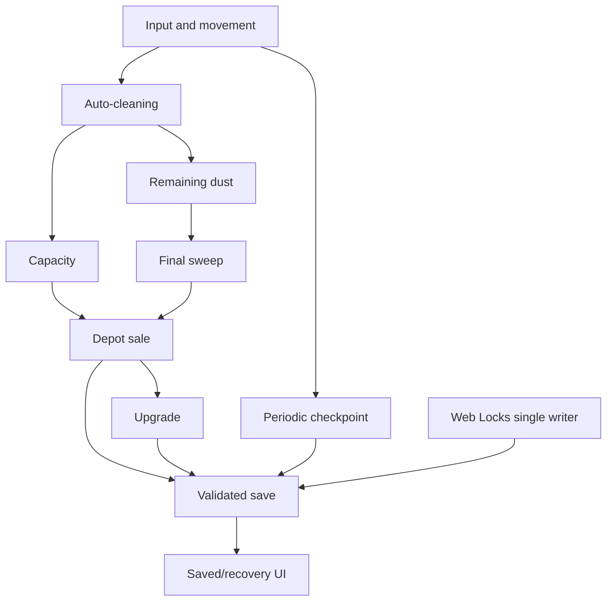

# The Sweeper — System Map (/map-systems)

Date: 2026-11-11. Branch: docs/map-systems-20261111. Scope: existing A-01 prototype; preserve main, gameplay and v1 save format.

## Evidence and boundaries

Inspected: `game/core.mjs`, `game/app.mjs`, `game/index.html`, `tests/core.test.mjs`, `docs/moon_sweepers_benchmark_design.md`, `docs/implementation_status.md`, and `docs/CCGS-INSTALLATION.md`. Source inspection is not runtime validation. The design document contains historical claims that the executable was not yet implemented; current implementation status and code supersede those historical statements.

## System inventory

| ID | System | Source / behavior | Status | Priority |
|---|---|---|---|---|
| SYS-01 | Input / movement | app.mjs keyboard, pointer joystick, return autopilot; core.mjs step normalizes movement | Implemented; device edge cases unverified | P1 |
| SYS-02 | Cleaning | core.mjs step forward-facing target selection; 6/sec or 7.2/sec | Implemented | P1 |
| SYS-03 | Capacity | core.mjs 90-unit bag and stop-at-capacity | Implemented | Preserve |
| SYS-04 | Depot sales | core.mjs near/sell, explicit depot transaction | Implemented | Preserve |
| SYS-05 | Upgrade | core.mjs upgrade once for 50 credits | Implemented | P2 |
| SYS-06 | Completion / reward | core.mjs finish at remaining <=4; sell awards one-time 100 | Implemented; failure boundary needs browser tests | P0 |
| SYS-07 | Persistence / recovery | core.mjs version 1, invariant validation, current/previous; app.mjs pending retry | Implemented; failure paths require browser validation | P0 |
| SYS-08 | Single writer | app.mjs navigator.locks ifAvailable; no Web Locks fallback | Implemented; contention unverified | P0 |
| SYS-09 | Rendering / UI | Canvas 2D, progress, bag, wallet, buttons, dialog | Implemented; 360px and device checks pending | P1 |
| SYS-10 | Extra sectors / drone / material types | Design only | Not implemented | P2 |
| SYS-11 | Optional chance rewards | Design only, explicitly absent from prototype | Not implemented | P3 |
| SYS-12 | Android package | Roadmap only | Not implemented | P3 |

## Dependency graph

## Confirmed code risks and verification needs

1. **P0 save failure recovery:** app.mjs keeps a pending snapshot after persist throws. Test retry, modal state, repeated clicks, tab visibility, and failure at completion. Do not silently discard or double-apply a transaction.
2. **P0 completion:** test remaining 0..5, full bag, sale vs finish, repeated clicks, failed save and reload. Preserve invariant `remaining + bag + sold === 900` and single 100-credit reward.
3. **P0 single writer:** test two tabs, lock loss/denial, reload, unsupported Web Locks. No localStorage lease fallback is implemented; unsupported browsers are blocked intentionally.
4. **P1 input:** test pointercancel, lostpointercapture, blur, orientation, screen-edge dragging, pause/resume and 360px touch targets.
5. **P1 performance:** app.mjs calls remaining(s) inside tile rendering. Compute once per frame before drawing to avoid repeated reductions as map grows; benchmark before claiming improvement.
6. **P1 accessibility:** dialog content uses newline characters in a paragraph; verify line-break presentation and screen-reader feedback.

## Execution plan and acceptance gates

- **P0-A:** add deterministic core regression cases for final sweep, completion reward and failed persistence. Gate: node --test tests/*.test.mjs passes, no v1 schema change.
- **P0-B:** browser tests for failed save, two tabs and completion after reload. Gate: repeatable browser evidence and no duplicated credits.
- **P1-A:** input cancellation/360px viewport checks, then minimal targeted fixes. Gate: Android Chrome and iPhone Safari checks clearly distinguished from desktop emulation.
- **P1-B:** render reduction optimization with no gameplay or save changes. Gate: screenshot parity and stable test results.
- **P2:** only after P0/P1 gates, prototype one new sector/choice; preserve old saves or implement an explicitly tested migration.
- **P3:** optional bonuses and Android package only after core-loop playtest and design approval.

## Delivery state at document creation

Documentation-only change. No gameplay or save schema modifications. Existing automated test outcomes are historical records, not newly executed tests. Commit, CI, GitHub Pages deployment and live URL verification must each be recorded separately; do not mark them complete based on this document.
